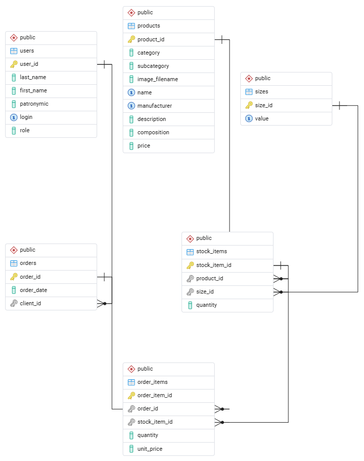

# «Чудо Обувь»

Настольное приложение магазина обуви на Python, PySide6 и PostgreSQL. Проект переработан по требованиям TASK2: данные из пяти Excel-файлов перенесены в нормализованную модель, а устаревшие сущности и сценарии TASK1 удалены.

## Возможности

- вход только по логину или просмотр каталога в гостевом режиме;
- роли «Авторизованный пользователь», «Менеджер» и «Администратор»;
- каталог с поиском по названию и описанию, фильтром категории и сортировкой по цене;
- карточка модели с размерным рядом, остатками и выбором доступного размера;
- автоматическая скидка 25%, если модель не продавалась в предыдущем календарном месяце;
- формирование многопозиционного заказа и проверка остатков в транзакции;
- просмотр и удаление заказов менеджером и администратором;
- изменение даты заказа и удаление позиции администратором;
- восстановление точного остатка при удалении позиции или заказа;
- фирменные цвета TASK2, Calibri, логотип, иконка и изображения моделей;
- заглушка изображения при отсутствии файла и красное выделение малого остатка (не более 3 шт.).

## Быстрый запуск

Требуется Python 3.11+ и PostgreSQL 14+.

```powershell
python -m venv .venv
.\.venv\Scripts\Activate.ps1
python -m pip install -r requirements.txt
```

Создайте отдельную базу данных:

```powershell
createdb -U postgres chudo_obuv
psql -U postgres -d chudo_obuv -f database.sql
```

`database.sql` пересоздаёт таблицы приложения, поэтому его следует запускать в выделенной базе `chudo_obuv`, а не в базе с другими данными.

Скопируйте `.env.example` в удобное место или задайте переменные окружения перед запуском:

```powershell
$env:CHUDO_DB_HOST = "127.0.0.1"
$env:CHUDO_DB_PORT = "5432"
$env:CHUDO_DB_NAME = "chudo_obuv"
$env:CHUDO_DB_USER = "postgres"
$env:CHUDO_DB_PASSWORD = "ваш_пароль"
python app.py
```

Пароль пользователя приложения не требуется. Примеры логинов из TASK2:

| Роль | Логин |
|---|---|
| Администратор | `isivanov` |
| Менеджер | `papetrov` |
| Авторизованный пользователь | `asidorova` |

Также можно выбрать «Продолжить без входа» и открыть каталог в режиме просмотра.

## Данные и повторный импорт

Исходные таблицы TASK2 сохранены в `database/resources/import`. Проверить их без изменения базы:

```powershell
python -m database.import_data
```

Пересоздать таблицы и загрузить проверенные данные в базу, указанную переменными `CHUDO_DB_*`:

```powershell
python -m database.import_data --apply
```

Импорт проверяет точные заголовки файлов, уникальность логинов, размеров и товарных остатков, а также все внешние ссылки. После нормализации загружаются 20 пользователей, 31 модель, 35 размеров, 92 складские позиции, 10 заказов и 30 позиций заказов.

## Структура проекта

```text
app.py                     точка входа и навигация QStackedWidget
database/                  конфигурация, схема, запросы, импорт и resources
database/resources/        изображения, логотип, иконка и исходные Excel-файлы
frames/                    экраны и связанная с ними прикладная логика
session.py                 текущая сессия и ролевая модель
scripts/                   генераторы database.sql и ER_Diagram.pdf
tests/                     модульные тесты и UI smoke-тесты
database.sql               готовая структура PostgreSQL с данными
ER_Diagram.pdf             ER-диаграмма нормализованной базы
TASK2_COMPLIANCE.md        итоговая таблица соответствия требованиям
```

## Модель данных

Основные таблицы: `users`, `products`, `sizes`, `stock_items`, `orders`, `order_items`. Размер и остаток принадлежат конкретной паре «модель + размер», а позиция заказа ссылается на эту складскую позицию. Цена позиции фиксируется в момент оформления.

Скидка рассчитывается динамически: границы предыдущего календарного месяца строятся относительно текущей даты, после чего проверяются продажи модели через `orders`, `order_items` и `stock_items`.

## Проверка

Для проверки входных Excel-файлов без подключения к PostgreSQL:

```powershell
python -m database.import_data
```

Подробный аудит требований находится в `TASK2_COMPLIANCE.md`.

## ER-диаграмма

<p align="center">
  
  <br>
  <em>Нормализованная модель: users, products, sizes, stock_items, orders, order_items</em>
</p>

## Запуск PostgreSQL через Docker Compose (практическая работа № 12)

Для проекта используется PostgreSQL 14 в контейнере. Графическое приложение
PySide6 по-прежнему запускается непосредственно в Windows, а не внутри Docker.
Вспомогательный контейнер `db-check` проверяет подключение к PostgreSQL.

### Предварительные требования

- Docker Desktop запущен в режиме Linux containers;
- доступны Docker Engine и Docker Compose v2;
- установлен Python 3.11+ для запуска настольного приложения и импорта Excel.

### Настройка переменных окружения

Скопируйте пример и укажите собственный локальный пароль в обеих переменных
пароля:

```powershell
Copy-Item .env.example .env
notepad .env
```

Файл `.env` исключён из Git. Не публикуйте его содержимое и не добавляйте пароль
в Dockerfile или `compose.yaml`.

### Сборка и запуск контейнеров

Команды выполняются из корня проекта:

```powershell
docker --version
docker compose version
docker info --format '{{.OSType}}'
docker compose config --quiet
docker build -t chudo-obuv-db-check:1.0 ./docker/db-check
docker image ls chudo-obuv-db-check
docker compose up --build -d
docker compose ps
docker compose logs --tail=40 db
docker compose logs --tail=40 db-check
docker compose run --rm db-check
```

Ожидается, что `db` будет иметь состояние `healthy`, а одноразовая проверка
`db-check` завершится с кодом 0 и выведет имя базы и число таблиц. Для
`db-check` адрес PostgreSQL — `db:5432`: это внутреннее имя сервиса в сети
Compose.

### Загрузка структуры и данных проекта

В отличие от учебного примера с `shoe_store.sql`, данный проект хранит структуру
в `database/schema.sql`, а исходные данные — в пяти Excel-файлах каталога
`database/resources/import`. Поэтому загрузка выполняется штатным импортёром
проекта, а не командой `psql -f`:

```powershell
python -m pip install -r requirements.txt
python -m database.import_data
python -m database.import_data --apply
docker compose run --rm db-check
```

ВНИМАНИЕ: параметр `--apply` пересоздаёт таблицы и загружает набор данных.
Используйте его только для новой учебной базы или после резервного копирования
нужных данных. Не запускайте повторно без необходимости.

### Подключение настольного приложения

Приложение запускается на Windows:

```powershell
python app.py
```

В `.env` для приложения указаны `CHUDO_DB_HOST=127.0.0.1` и
`CHUDO_DB_PORT=5433`. Это опубликованный порт Windows. Внутри контейнерной
сети используется `db:5432`. Если порт 5433 занят, измените
`POSTGRES_HOST_PORT` и `CHUDO_DB_PORT` на одинаковое свободное значение.

### Проверка и остановка

Проверьте запуск окна, отображение каталога, названий товаров, цен и остатков.
Затем выполните:

```powershell
docker compose exec db pg_isready -U postgres -d chudo_obuv
docker compose stop
docker compose start
docker compose run --rm db-check
```

В этой практической работе постоянный именованный том намеренно не настроен:
гарантированное сохранение данных при пересоздании контейнера относится к
следующей практической работе. Не используйте `docker compose down -v`, если
нужно сохранить текущие данные.

### Диагностика связи сервисов

Для учебной проверки временно измените `DB_HOST: db` на `DB_HOST: wrong-db`
в `compose.yaml`, затем выполните:

```powershell
docker compose run --rm db-check
```

Проверка должна завершиться ошибкой разрешения имени/подключения. После этого
верните `DB_HOST: db` и повторите запуск `docker compose run --rm db-check`.
Журналы доступны командой `docker compose logs --tail=30 db-check`.
